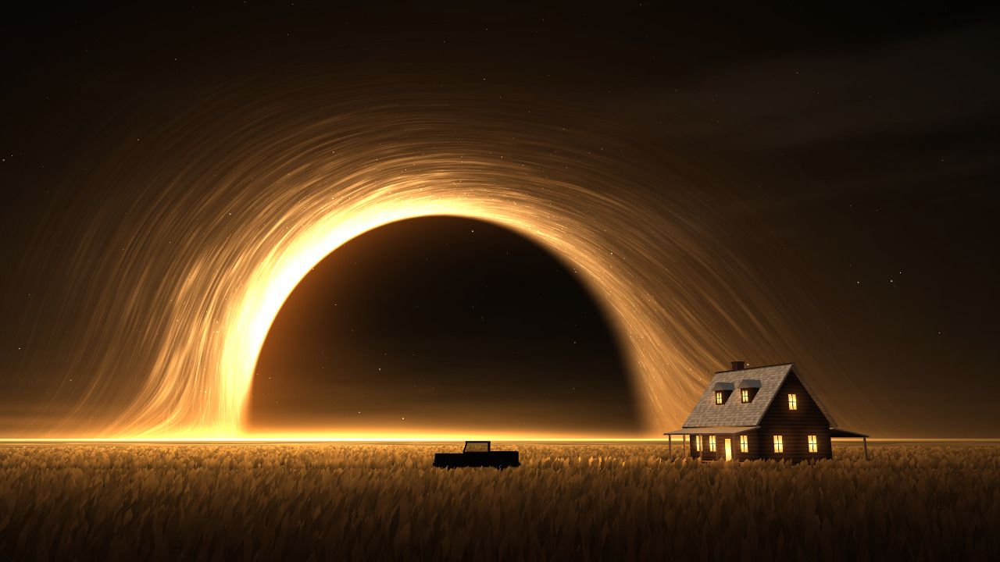
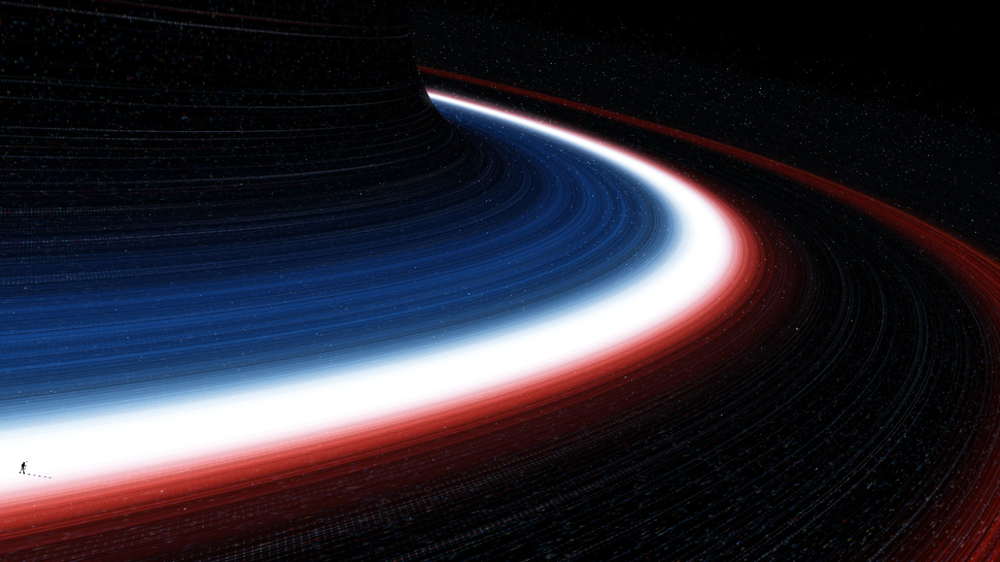
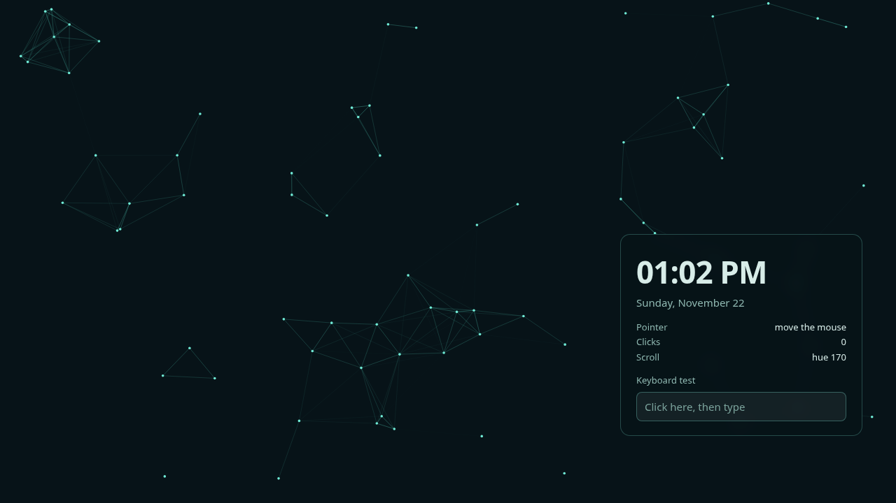

<div align="center">


# LiveCanvas

**Interactive HTML, WebGL, and Web-App Live Wallpapers for Windows 11**

Turn any local `.html` file, Three.js scene, web folder, or live URL into a clickable, draggable, scrollable desktop wallpaper **behind your desktop icons**—powered directly by Windows' built-in WebView2 runtime in a single native Rust binary.

[](https://github.com/Abinanthan-CG/livecanvas/releases/latest)
[](https://github.com/Abinanthan-CG/livecanvas/actions/workflows/build.yml)
-0078D4?logo=windows&logoColor=white)


[**Download Installer (`v1.0.1`)**](https://github.com/Abinanthan-CG/livecanvas/releases/latest/download/livecanvas-setup.exe) · [**Portable `.exe`**](https://github.com/Abinanthan-CG/livecanvas/releases/latest/download/livecanvas.exe) · [**Live Examples**](#live-examples) · [**Configuration**](#configuration) · [**Build from Source**](#build-from-source)

<br>



*`examples/golden_singularity_wheat_field_at_night.html` — 68,000 wind-blown wheat stalks, glowing farmhouse, and golden accretion arc rendered live in WebGL.*

</div>

## Why LiveCanvas?

| | |
| --- | --- |
| **Zero runtime bloat** | Uses the Evergreen WebView2 runtime already shipped with Windows 11. No Electron, no Tauri, no Node.js—just a single statically linked `~584 KB` portable Rust binary. |
| **Interactive behind desktop icons** | Forwards mouse hover, clicks, double-clicks, drag, scroll wheels, and optional keyboard focus while preserving normal desktop icon clicks via MSAA hit-testing—with zero DLL injection into `explorer.exe`. |
| **Game & battery friendly** | Automatically hides and suspends the WebView2 renderer (freeing CPU, GPU, and RAM) whenever a full-screen game or video covers the desktop. |
| **Secure local HTTPS origin** | Maps local folders to `https://livecanvas.example/` with `DENY_CORS` isolation so ES modules, sibling `fetch()`, shaders, and `localStorage` work like a real server—and clears the mapping when switching to remote URLs. |
| **Persistent logins & sessions** | Cookies and storage persist in `%LOCALAPPDATA%\LiveCanvas\WebView2`, so web apps, music players, and dashboards stay signed in across reboots. |
| **Resilient & zero admin rights** | Installs per-user with no UAC prompt, re-attaches after `explorer.exe` restarts or display changes, supports Windows 11 24H2+ raised desktops, and applies exponential backoff on renderer crashes. |

## Live Examples

Three interactive wallpapers ship with LiveCanvas so you can test orbit controls, scroll zoom, parallax, keyboard focus, and adaptive frame-rate throttling immediately.

<table>
  <tr>
    <td width="50%" valign="top">
      <a href="examples/at_the_edge_of_infinity.html">
        
      </a>
      <br><br>
      <strong>At the Edge of Infinity</strong><br>
      <code>examples/at_the_edge_of_infinity.html</code><br><br>
      165,000 orbiting starlight particles, HDR bloom, a lone silhouetted traveler, 60 / 30 / 15 fps adaptive idle loop, and automatic 2D Canvas fallback.<br><br>
      <strong>Controls:</strong> Drag to orbit · Scroll to zoom · Hover parallax · Double-click or <code>R</code> to reset · <code>Space</code> to pause · Arrow keys / <code>+</code> <code>-</code>
    </td>
    <td width="50%" valign="top">
      <a href="examples/golden_singularity_wheat_field_at_night.html">
        
      </a>
      <br><br>
      <strong>Golden Singularity — Wheat Field at Night</strong><br>
      <code>examples/golden_singularity_wheat_field_at_night.html</code><br><br>
      68,000 instanced wind-blown wheat stalks, glowing farmhouse, pickup truck, and a towering golden accretion arc with a 60 / 30 fps eco loop.<br><br>
      <strong>Controls:</strong> Drag to orbit · Scroll to zoom · Hover parallax · Double-click to reset
    </td>
  </tr>
</table>

```powershell
# Launch either Three.js example from PowerShell (or pick it via Tray → Use HTML file...)
.\livecanvas.exe .\examples\at_the_edge_of_infinity.html
.\livecanvas.exe --set .\examples\golden_singularity_wheat_field_at_night.html
```

> **Note:** Both Three.js examples load `three.min.js` (`r128`) from cdnjs on first run; WebView2 caches it in `%LOCALAPPDATA%\LiveCanvas\WebView2` afterward.

### Built-in Interactive Demo (Default)



Shown automatically on first launch when no `source` is configured. Includes an interactive particle constellation, live clock, pointer/click/scroll telemetry, and a keyboard input box to verify focus forwarding.

## Quick Start

1. Download [**`livecanvas-setup.exe`**](https://github.com/Abinanthan-CG/livecanvas/releases/latest/download/livecanvas-setup.exe) (per-user installer, no admin rights) or [**`livecanvas.exe`**](https://github.com/Abinanthan-CG/livecanvas/releases/latest/download/livecanvas.exe) (portable single binary) from [**Releases**](https://github.com/Abinanthan-CG/livecanvas/releases/latest).
2. Run LiveCanvas—the built-in interactive demo appears immediately behind your desktop icons.
3. Click the **LiveCanvas** tray icon to pick an `.html` file, a folder with `index.html`, or a URL from your clipboard.
4. Press **`Ctrl+Alt+I`** anytime to toggle mouse interactivity on or off.

The installer places files in `%LOCALAPPDATA%\Programs\LiveCanvas`, adds a Start Menu shortcut, and registers in **Settings → Apps → Installed apps** (uninstall from Windows Settings or with `uninstall.exe --uninstall`).

## Usage & CLI

Right-click or left-click the tray icon for file/folder pickers, clipboard URL/path loading, interactivity/keyboard/mute toggles, DevTools, autostart, and `config.toml` editing.

```text
livecanvas.exe [SOURCE]         URL, .html file, or folder with index.html
livecanvas.exe --set <SOURCE>   Switch a running instance to a new source
livecanvas.exe --reload         Reload the current page
livecanvas.exe --toggle-interactive
livecanvas.exe --mute | --unmute
livecanvas.exe --autostart <on|off>
livecanvas.exe --quit           Stop the running instance
```

Bare local dev addresses (`localhost:3000`, `127.0.0.1:5173`) default to `http://`; remote domains without a scheme default to `https://`.

## Configuration

Settings live in `%LOCALAPPDATA%\LiveCanvas\config.toml`. After editing, select **Apply config.toml** from the tray menu.

| Key | Default | Description |
| --- | --- | --- |
| `source` | `""` | URL, `.html` file, or folder with `index.html`. Empty shows the built-in demo. |
| `monitor` | `"primary"` | `"primary"`, `"span"` (all monitors), or a zero-based monitor index (e.g. `"1"`). |
| `interactive` | `true` | Forward mouse input from the bare desktop to the wallpaper. |
| `keyboard` | `true` | Move keyboard focus into the page when clicked. |
| `forward_right_click` | `false` | Also forward right-clicks (the desktop context menu still opens). |
| `muted` | `false` | Mute all audio produced by the page. |
| `pause_when_covered` | `true` | Hide and suspend the renderer while a full-screen window covers the desktop. |
| `zoom` | `1.0` | Page zoom factor (`0.25` to `5.0`). |
| `devtools` | `true` | Allow opening Chromium DevTools from the tray menu. |
| `user_agent` | `""` | Optional custom user-agent string. |
| `hotkey` | `true` | Register `Ctrl+Alt+I` to toggle interactivity. |

## Build from Source

Requirements: Windows 10/11, stable Rust (MSVC toolchain), and Visual Studio Build Tools (*Desktop development with C++*).

```powershell
.\build.ps1                                  # x64  -> .\dist\livecanvas.exe + livecanvas-setup.exe
.\build.ps1 -Target aarch64-pc-windows-msvc  # ARM64
```

`build.ps1` runs `cargo test -p livecanvas-core`, builds `livecanvas.exe`, and then builds `livecanvas-setup.exe` with `livecanvas.exe` embedded as its payload.

<details>
<summary><strong>Architecture, Verification Status & Known Limitations</strong></summary>

### How It Works

1. **Shell layer (`desktop.rs`):** Message `0x052C` asks `Progman` to split the desktop into wallpaper and icon layers. LiveCanvas parents a child window under the wallpaper `WorkerW` on Windows 10 / 11 up to 23H2, or as a `WS_EX_LAYERED` child of `Progman` directly below `SHELLDLL_DefView` on Windows 11 24H2+.
2. **Rendering (`webview.rs`):** A WebView2 *composition controller* renders into a DirectComposition visual tree owned by our surface window.
3. **Input (`input.rs`):** A low-level mouse hook (`WH_MOUSE_LL`) queues events without swallowing them; the message loop replays events via `ICoreWebView2CompositionController::SendMouseInput` when the cursor is over the bare desktop and not over an icon (`AccessibleObjectFromPoint` / `ROLE_SYSTEM_LISTITEM`).
4. **Local isolation (`source.rs`, `webview.rs`):** Local folders map to `https://livecanvas.example/` with `COREWEBVIEW2_HOST_RESOURCE_ACCESS_KIND_DENY_CORS`, and the mapping is cleared when navigating to remote URLs.
5. **Resilience (`app.rs`, `webview.rs`):** A 1-second watchdog recovers from `explorer.exe` restarts and display changes, ignores recoverable WebView2 sub-process failures, and applies exponential backoff on repeated browser/renderer crashes.

### Verification Status

| Check | Status |
| --- | --- |
| `cargo test -p livecanvas-core` (22 unit tests) | Passes (local + Windows CI) |
| `cargo clippy --workspace -- -D warnings` (`x86_64` & `aarch64`) | Passes (enforces `clippy::undocumented_unsafe_blocks`) |
| Windows MSVC release build (`livecanvas.exe` & `livecanvas-setup.exe`) | Passes on GitHub Actions (`windows-latest`) |
| Live WebGL rendering of bundled examples & built-in demo | Verified in Chromium WebGL |
| Interactive desktop testing on Windows 11 24H2 | Recommended first-run check on target hardware |

### Known Limitations

- The mouse cursor shape does not change to match CSS cursors (a hook cannot override the cursor for an `explorer.exe`-owned window).
- Input is observed rather than swallowed: dragging on the wallpaper also draws the desktop selection rectangle, and forwarded right-clicks still open the desktop context menu.
- Touch, pen, and side mouse buttons are not forwarded.
- `0x052C` is an undocumented (though long-standing since Windows 8) shell message.
- While attached to the shell's input queue, the release binary uses `panic = "abort"` so a bug can never stall the desktop.

</details>

## License

MIT — see [`LICENSE`](LICENSE).
